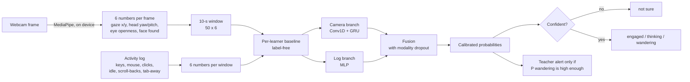
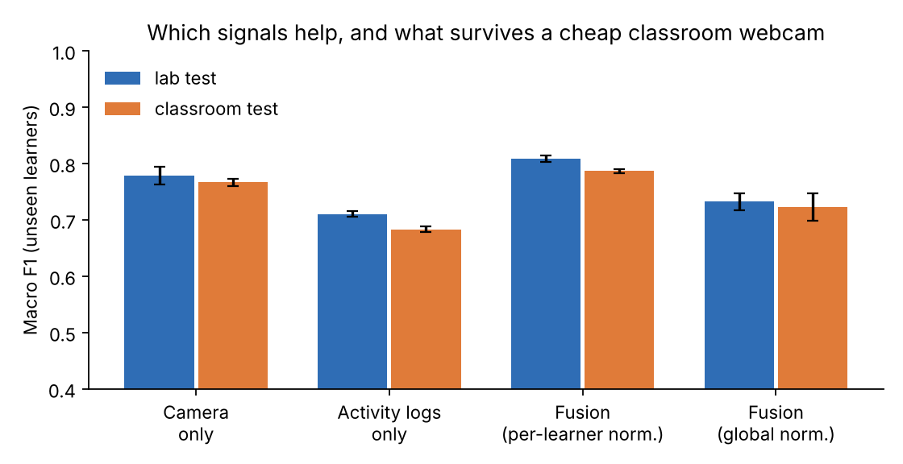
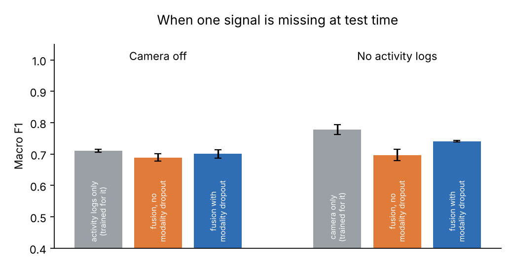
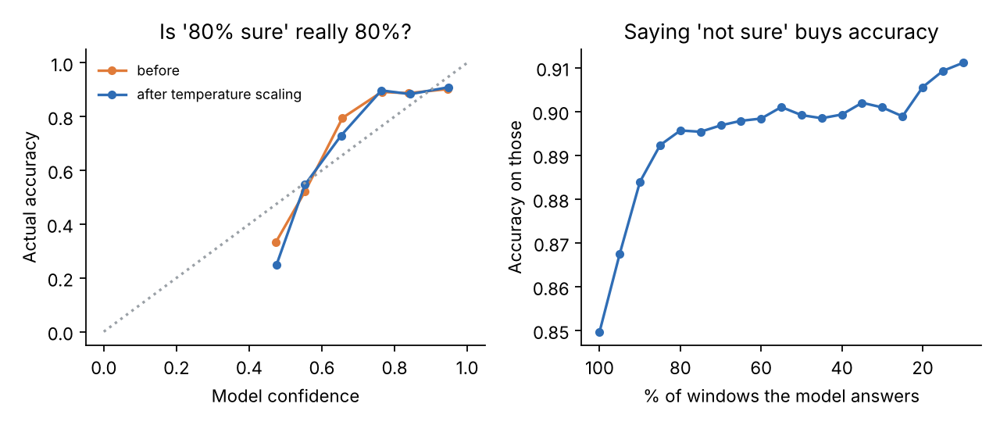
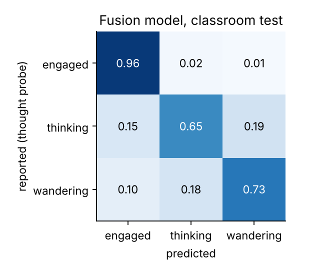

# ClassWatch: privacy-first classroom attention

ClassWatch looks at a classroom through a laptop webcam without recording anyone. Its research part is a small multimodal model that estimates whether a learner is **engaged**, **thinking hard**, or **mind wandering**. It combines webcam features (gaze, head pose, blinks) with activity logs (typing, clicks, scrolling). It keeps the video on the device, and when it is unsure it says **"not sure"** instead of guessing.

> **The attention model's data is simulated.** No real student was recorded. The simulator stands in for a real thought-probe study, so that the whole pipeline (features → fusion model → calibrated, cautious alerts) can be built and tested first. The numbers below show how the method behaves, not how well it would work on real learners.

**This repository has two parts:**

| Part | What it is | Run it |
|---|---|---|
| **[ClassWatch Live](live/)** | A real-time classroom demo on a laptop webcam: people in view (anonymous IDs), hands raised, heads front/turned/down/away, standing/sitting, phones, door in/out, with faces blurred and nothing saved. | Windows: [download the installer](https://github.com/Zubair-DLCS/ClassWatch/releases/latest) and click the desktop icon. Or `python live/app.py` |
| **Attention model** (below) | Research prototype: tells *thinking hard* from *mind wandering* by fusing per-learner webcam features with activity logs, with calibration and "not sure". Trained and tested on simulated data. | `python scripts/run_experiments.py` |

## Multimodal learning analytics and adaptive learning environments

ClassWatch sits where two research areas meet.

**Multimodal learning analytics.** No single signal tells you whether a learner is with the lesson, so ClassWatch combines several:

- The **attention model** fuses webcam features (gaze, head pose, eye openness, blinks) with interaction logs (keystrokes, mouse, clicks, idle time, scrolling back, tab switches). It is trained with modality dropout, so it still works when the camera or the logs are missing.
- The **live demo** adds classroom-level signals: people in view, raised hands, head direction and posture, aggregated for the whole class.

**Adaptive learning environments.** A detector only helps if something sensible happens next. The attention model is built as the sensing layer of an adaptive environment, and its decision layer is part of the design:

| Model output | Suggested response | Why |
|---|---|---|
| Engaged | nothing | do not interrupt learning |
| Thinking hard | nothing; give time | interrupting a thinker is the costliest mistake |
| Mind wandering, above the alert threshold | a quiet, private nudge: a short question, a pause, or a hint to the teacher | the threshold is set so that at most ~10% of thinkers are flagged |
| "Not sure" (confidence below 60%) | nothing | a confident wrong answer is worse than no answer |

**Not built yet:** the learning environment that delivers these responses, and a study testing whether they actually help learning. Both are natural next steps.

## Why

Every teacher wants to know two things during a lesson: who is with me, and who has understood? Students rarely say so. You can read faces, but you cannot watch every face while you teach, and staring at students makes them nervous.

A model could help, but only if it can be trusted. It must not send video anywhere. It must not mark a quiet, thoughtful student as "not paying attention". It must still work with a cheap classroom webcam. It must know when it does not know. This repository is a small attempt to build a model with those properties from the start.

The hardest part, and the focus here, is telling **thinking hard** apart from **mind wandering**. From the front of the room both look the same: still, quiet, eyes away from the screen. A teacher should wait for the first and help the second.

## How it works



| Design choice | Why it matters in a classroom |
|---|---|
| **Video never leaves the device.** Each frame becomes six numbers ([`webcam.py`](src/classattend/webcam.py)); the image is then discarded. | Student video is personal data. A school should never need to store it. |
| **Per-learner baseline.** Features are compared with the learner's own average, using no labels. | Some people blink more or sit with the head turned. That is not inattention. |
| **Modality dropout.** During training one signal is randomly hidden. | Cameras get covered and logs go missing. The model should degrade, not break. |
| **Calibration + abstention.** Temperature scaling, then "not sure" below 60% confidence. | A confident wrong answer about a student is worse than no answer. |
| **Alert budget for thinkers.** The alert threshold is set so that at most 10% of thinking learners are wrongly flagged (on validation data). | Wrongly flagging a hard-thinking student is the most harmful mistake. |
| **Learner-wise splits.** No learner appears in both training and test data. | Otherwise the model memorises people instead of states. |
| **Lab → classroom test.** Train on good-camera data, test on new learners with a cheap webcam, poor light and tracking loss. | Real classrooms are not labs. |

## Results

60 simulated learners for training/validation/testing (lab camera) and 20 new learners for the classroom test, 120 ten-second windows each. Labels include 8% mis-reports, as thought probes do in real studies. Mean ± std over 3 seeds; macro F1 on unseen learners (chance = 0.33).

| Model | Lab test | Classroom test |
|---|---|---|
| Camera only | 0.779 ± 0.016 | 0.767 ± 0.007 |
| Activity logs only | 0.711 ± 0.005 | 0.683 ± 0.005 |
| Fusion, global normalisation | 0.732 ± 0.015 | 0.723 ± 0.025 |
| **Fusion, per-learner baseline** | **0.809 ± 0.006** | **0.787 ± 0.004** |



**When a signal is missing at test time**

| Missing | Single model trained for that case | Fusion, no modality dropout | Fusion with modality dropout |
|---|---|---|---|
| Camera off | 0.711 (logs only) | 0.689 ± 0.012 | 0.701 ± 0.013 |
| No activity logs | 0.779 (camera only) | 0.697 ± 0.018 | 0.741 ± 0.003 |



**Alerts to the teacher** (fusion model, classroom test, threshold chosen on validation data)

| | Rate |
|---|---|
| Mind-wandering windows that raise an alert | 61.7% ± 5.5 |
| Thinking-hard windows wrongly flagged | 9.3% ± 1.1 |
| Engaged windows wrongly flagged | 1.0% ± 0.3 |




### What the results say

1. **Two signals beat one, but only a little** (+3 F1 over the camera alone). The gain comes from windows where one signal is unclear and the other is not.
2. **The per-learner baseline matters more than fusion** (+8 F1 over a global scale). Comparing a learner with themselves is cheap, needs no labels, and can run on the learner's own device.
3. **The cheap webcam costs about 2 F1 points.** The per-learner baseline absorbs much of the lighting and camera offset.
4. **Modality dropout helps, but is not enough.** With the activity logs missing, the fusion model (0.741) still falls short of a model trained on the camera alone (0.779). A deployed system should keep single-signal fallback models.
5. **The model was already fairly well calibrated** (ECE 0.056 → 0.052 after temperature scaling; T ≈ 0.98). Answering only on its most confident 80% of windows raises accuracy from 85% to about 90%. Higher than that is limited by the 8% of wrong labels.
6. **Thinking vs. wandering remains the hard case.** 19% of thinking windows are predicted as wandering. With the alert budget, about 1 in 11 thinkers would still be flagged. In a real classroom that is too many to act on automatically, so the output should be a quiet hint to the teacher, never a mark against the student.

## Run it

```bash
pip install -r requirements.txt
python scripts/run_experiments.py          # all results + figures, ~6 min on a laptop CPU
python scripts/run_experiments.py --quick  # 1-minute smoke test
pytest -q                                  # unit tests
```

Try the camera pipeline on your own recording (needs a webcam video of at least 30 s):

```bash
python scripts/demo_video.py my_clip.mp4      # or: --webcam --seconds 120
```

It writes `results/demo/timeline.png`, `timeline.csv` and `features_per_frame.csv`. **No images are saved.** The demo has no activity logs, so it runs the camera branch only. The model was trained on simulated data, so the timeline is a demonstration of the pipeline, not a judgement about the person in the video.

Or open [`notebooks/colab_quickstart.ipynb`](notebooks/colab_quickstart.ipynb) in Google Colab.

## Repository layout

```
live/
  app.py               start window (the Windows app opens this)
  classwatch_live.py   real-time classroom demo (webcam, pose, tracking, cues, dashboard)
  cues.py              hand raised, head direction, sitting/standing, door counter, smoothing
src/classattend/
  simulate.py   simulated sessions: 3 states, individual differences, lab vs classroom camera
  data.py       per-learner baseline, global baseline, learner-wise splits
  model.py      camera branch (Conv1D+GRU), log branch (MLP), fusion with modality dropout, temperature scaling
  evaluate.py   macro F1, calibration error, risk-coverage, alert threshold with a budget for thinkers
  webcam.py     on-device MediaPipe features from a webcam or video; frames are never stored
scripts/
  run_experiments.py   every number and figure in this README
  demo_video.py        run the trained model on your own recording
packaging/             app icon and Windows installer script
.github/workflows/     builds, tests and publishes the Windows app
tests/                 unit tests (simulator, features, missing modality, alert budget, live-demo cues)
results/               metrics.json, figures, trained fusion model (seed 0)
```

## Limitations and next steps

- **Simulated data.** The simulator encodes hand-set assumptions (for example, more blinks and drifting gaze while mind wandering, long fixations while thinking, both quiet on the keyboard). Real behaviour is messier. The next step is a small real study with thought probes, eye tracking and logs, and replacing `simulate()` with that data.
- **Fairness is untested.** Gaze and eye-openness features can behave differently across faces, glasses, lighting and cameras. Each group needs its own error rates before any use.
- **Thought probes are imperfect labels.** Learners mis-report, and asking interrupts the very state being measured.
- **Window-level only.** States are predicted per 10-second window. Using the sequence of windows (states last for a while) should help.

## Author

**Malak Zubair**, Assistant Professor of Computer Science, G.C.M.S Timergara, Higher Education Department, Khyber Pakhtunkhwa, Pakistan. GitHub: [Zubair-DLCS](https://github.com/Zubair-DLCS)

MIT licence.
